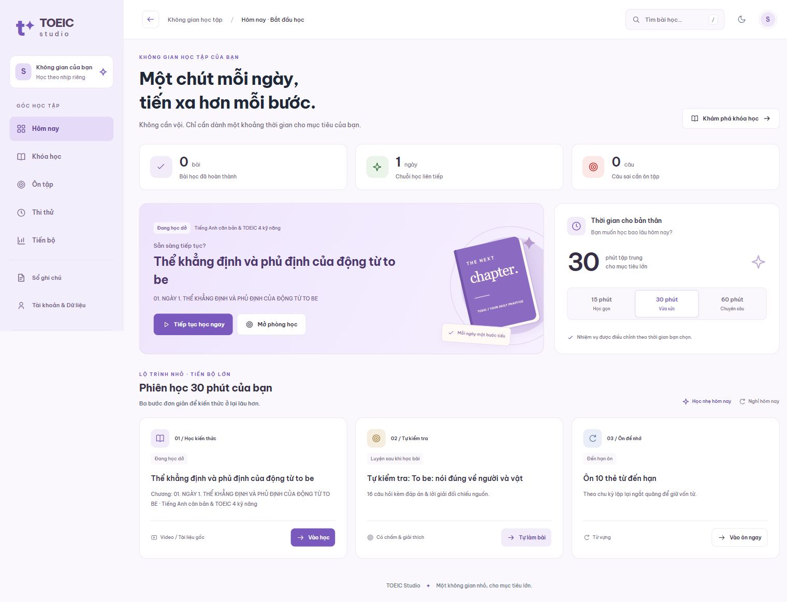
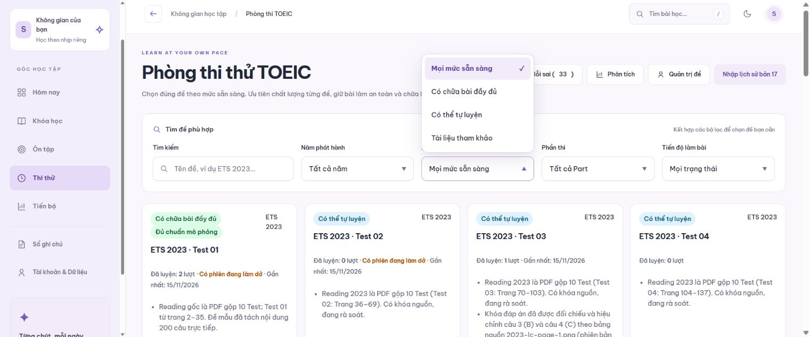

# TOEIC Studio — Quy chuẩn UX/UI

Tài liệu thiết kế dùng chung cho các phần hiện tại và tính năng phát triển sau
này. Khi thay đổi component, cập nhật CSS và tài liệu này cùng nhau.

## 1. Hướng thiết kế

Listening Studio (`#listening`) dùng `.ui-filter-panel`, `.ui-filter-bar`,
`.ui-field`, `.ui-input` cho nhập file và chọn tốc độ; player giữ audio controls
native. CSS `listening-studio.css` chỉ bố trí vùng luyện/danh sách câu và trạng
thái riêng: câu hiện tại có `aria-current`, nút lặp có `aria-pressed`, từ thiếu
có nhãn “Thiếu”, từ thừa có nhãn “Thừa” để không phụ thuộc màu sắc.

Không gian học tập yên tĩnh, rõ ràng, dễ quay lại mỗi ngày. Màu chủ đạo là tím
lavender, nền trắng pha tím rất nhẹ, thanh điều hướng tím phấn và khối học tiếp
chuyển sắc lavender mềm. Mỗi khu
vực có một hành động chính; các thao tác bổ sung dùng nút viền hoặc nút mềm.

Nội dung tiếng Việt ngắn, cụ thể. Nhãn cho biết người học đang chọn gì, giá trị
cho biết lựa chọn hiện tại. Trạng thái chưa có dữ liệu không được trông như lỗi.

## 2. Nguồn triển khai

| File | Vai trò |
| --- | --- |
| `src/client/studio-refresh.css` | Palette, khung ứng dụng, typography và trang Hôm nay |
| `src/client/ui-controls.css` | Token và component biểu mẫu/select dùng chung |
| `public/index.html` | Tải CSS nền → CSS trang → studio-refresh → ui-controls |
| `AGENTS.md` | Nhắc người/agent phát triển tuân theo tài liệu này |
| `docs/design/select-reference.jpg` | Ảnh tham chiếu bộ lọc và popup đã triển khai |
| `docs/design/home-reference.jpg` | Ảnh tham chiếu bố cục và palette lavender trên trang Hôm nay |

Các select thêm qua HTML hoặc render động đều được áp dụng thiết kế chung.
Không cần khởi tạo JavaScript, MutationObserver hoặc thay thế select bằng div.
CSS cũ theo trang vẫn có thể tồn tại; component mới phải dùng hệ thống này.

## 3. Token thiết kế

Không chép mã màu mới vào từng trang; dùng biến CSS có sẵn. Các tên `--purple`,
`--purple-dark`, `--lilac` là màu chủ đạo, hover và nền mềm trong palette tím.
Khi có dark mode, giá trị tự đổi trong `html.dark`. Màu xanh lá, vàng và đỏ chỉ
dùng cho trạng thái/nhóm nội dung có ý nghĩa, không thay màu tím chủ đạo.
`--surface`, `--surface-alt` và `--border` lần lượt là alias của `--paper`, `--bg` (và nền phụ tối trong `html.dark`) và `--line` cho các
module như phòng thi; không dùng màu trắng cố định làm nền thẻ trong dark mode.
Liên kết hành động `.text-button` dùng `--purple-dark` để giữ độ rõ trong cả giao diện sáng và tối.

| Token | Sáng | Mục đích |
| --- | --- | --- |
| `--bg` | `#faf8fd` | Nền ứng dụng |
| `--paper` | `#ffffff` | Thẻ, biểu mẫu, popup |
| `--ink` | `#362f46` | Nội dung chính |
| `--muted` | `#766c86` | Gợi ý, thông tin phụ |
| `--line` | `#e9e1f1` | Đường phân cách và viền thẻ |
| `--purple` | `#7959bd` | Màu hành động chính |
| `--purple-dark` | `#62449f` | Hover của nút chính |
| `--studio-soft` | `#f1ebfa` | Nền mềm cho trạng thái đã chọn |
| `--sidebar-bg` | `#f3eefb` | Nền thanh điều hướng |
| `--sidebar-active` | `#e5daf7` | Mục điều hướng hiện tại |
| `--hero-bg` / `--hero-end` | `#eee5fc` / `#f6f0ff` | Gradient của khối học tiếp |
| `--hero-ink` | `#4f386f` | Tiêu đề trên nền lavender |
| `--control-border` | `#e1d6ee` | Viền biểu mẫu |
| `--control-border-hover` | `#b59acf` | Viền hover/bộ lọc đang áp dụng |
| `--control-focus` | `#7959bd` | Focus và popup mở |
| `--control-ring` | `#7959bd20` | Vòng focus nhẹ |
| `--control-invalid` | `#b34c42` | Trường cần sửa |

- Font: `var(--font)` — Be Vietnam Pro, fallback system sans-serif.
- Tiêu đề trang: 25–34px desktop, 28px mobile. Nội dung biểu mẫu: 13px desktop,
  16px mobile. Nhãn: 11px desktop, 12px mobile. Gợi ý: 11px.
- Nhịp khoảng cách: 4 / 8 / 12 / 16 / 24 / 32px. Giữa nhãn và ô nhập: 8px.
- Bo góc: control 10px, option 7px, popup 12px, panel 14px, khối lớn 16px.
- Chiều cao control: tối thiểu 46px desktop, 48px mobile; compact 38px chỉ dùng
  cho công cụ phụ như tốc độ audio.
- Main sử dụng toàn bộ chiều rộng còn lại sau sidebar. Giữ padding hai bên,
  không thêm max-width cho khung toàn trang. Chỉ giới hạn bề rộng vùng đọc khi cần.
- Trên mobile, tiêu đề và nhóm hành động xếp dọc; không ép phần mô tả vào một
  cột hẹp bên cạnh nhiều nút. Topbar giữ chiều cao ổn định khi nội dung dài.

## 4. Select

### Hình thức và trạng thái

- Nền `--paper`, viền 1px, mũi tên nằm bên phải, nội dung căn trái.
- Hover tăng độ rõ của viền; focus có outline và vòng nhẹ. Không xóa outline.
- Popup có viền, bóng nhẹ, padding 6px, option cao tối thiểu 42px. Option đã
  chọn có nền tím nhạt, chữ đậm và dấu chọn; không chỉ phân biệt bằng màu.
- Popup giới hạn chiều cao 320px và tự cuộn, không che hết màn hình nhỏ.
- Disabled giảm opacity, con trỏ không cho thao tác; không dùng disabled để
  biểu diễn trạng thái rỗng có thể khắc phục.
- Trường lỗi có `aria-invalid="true"` và thông báo cụ thể liên kết qua
  `aria-describedby`. Không tô đỏ tất cả trường required ngay khi mở form.
- Màu sắc các trạng thái lấy từ token, kể cả trong dark mode.

### Hành vi

Giữ `<select>` native để có điều khiển bàn phím, công cụ hỗ trợ, `FormData`,
validation và sự kiện `change`. Không đổi ID, name hay value chỉ để sửa thiết kế.

`@supports (appearance: base-select)` nâng cấp giao diện cả ô đóng và popup.
Trình duyệt không hỗ trợ dùng select native với viền và mũi tên đồng bộ. Select
multiple/listbox (`multiple`, `size > 1`) không bị chuyển thành dropdown.
Chế độ forced colors giữ control native.

Không gắn click handler lên option để thay cho change. Đóng popup bằng Escape
không được sửa lựa chọn. Tab, phím mũi tên, Enter/Space và gõ để tìm option cần
tiếp tục hoạt động. Nhãn luôn hiển thị; placeholder không thay thế nhãn.

### Mẫu sử dụng

```html
<label class="ui-field">
  <span class="ui-field-label">Năm phát hành</span>
  <select id="year" name="year">
    <option value="all">Tất cả năm</option>
    <option value="2024">2024</option>
  </select>
</label>
```

Select không cần class để nhận style chung. Dùng `.ui-select--compact` khi có
lý do rõ ràng (khóa chiều cao một dòng `--control-height: 38px` trên desktop;
với tên dài trong `base-select`, dùng `<button type="button" class="ui-select-trigger"><selectedcontent></selectedcontent><svg class="ui-select-caret">…</svg></button>`
để cắt gọn bằng dấu `...` mà không đè lên mũi tên mở, trong khi vẫn giữ đầy
đủ chữ nhiều dòng ở danh sách mở ra); không thu nhỏ control chính để ép mọi
thứ vào một hàng.

Trường có hướng dẫn và thông báo lỗi:

```html
<label class="ui-field">
  <span class="ui-field-label">Khóa học</span>
  <select name="course" required aria-describedby="course-hint course-error"
          aria-invalid="true">
    <option value="">Chọn khóa học</option>
  </select>
  <small class="ui-field-hint" id="course-hint">Chọn khóa bạn muốn học tiếp.</small>
  <small class="ui-field-error" id="course-error">Hãy chọn một khóa học.</small>
</label>
```

## 5. Thanh bộ lọc và ô tìm kiếm

Nhóm các bộ lọc liên quan trong `.ui-filter-panel`. Mỗi bộ lọc có một nhãn và
một giá trị. Lựa chọn mặc định là option đầu tiên, ví dụ “Tất cả năm”. Bộ lọc
đổi khỏi mặc định có nhãn/viền tím và nền nhẹ. Đây chỉ là trạng thái hiển thị,
logic lọc vẫn sử dụng value của select.

```html
<section class="ui-filter-panel" aria-label="Bộ lọc bài học">
  <div class="ui-filter-bar">
    <label class="ui-field ui-field--search">
      <span class="ui-field-label">Tìm kiếm</span>
      <span class="ui-input-wrap">
        <!-- SVG .icon aria-hidden="true" nếu cần -->
        <input class="ui-input" type="search" name="q"
               placeholder="Tên bài học…">
      </span>
    </label>
    <label class="ui-field">
      <span class="ui-field-label">Tiến độ</span>
      <select name="status">
        <option value="all">Tất cả trạng thái</option>
        <option value="new">Chưa học</option>
      </select>
    </label>
  </div>
</section>
```

`.ui-filter-bar` tự chia cột theo số trường. Thanh lọc năm trường ở kho đề dùng
thêm `.ui-filter-bar--catalog` để ô tìm kiếm rộng hơn; bộ lọc học liệu ở chi tiết
khóa học dùng `.ui-filter-panel` + `.ui-filter-bar` tiêu chuẩn. Dưới 1150px, tìm kiếm chiếm hàng đầu,
các select chia hai cột; dưới 760px chuyển thành một cột. Nhóm hai bộ lọc ngắn
dùng `.ui-filter-bar--short`. Không đặt chiều rộng cố định lên select.

Trong phòng học (`#study`), chế độ mặc định **Khung lớn** (`.theater-active`) đặt
`.study-stage` trên toàn chiều ngang vùng học để video/PDF mở rộng thoải mái, vẫn giữ
thanh điều khiển `Video / Tài liệu PDF / Video + PDF song song` cùng `<select class="ui-select--compact">`
trong `.ui-field` cho danh sách chương và tài liệu.

Thanh cuối phòng học nằm trong luồng trang, không bám đáy đè lên điều khiển
video/PDF. Khung video dùng toàn bộ chiều rộng vùng học, giữ tỷ lệ 16:9 và
cho phép cuộn dọc khi cửa sổ thấp; không thu nhỏ video bằng giới hạn theo chiều
cao viewport. Nút “Toàn màn hình” mở riêng khung video ra toàn màn hình trình
duyệt; nếu trình duyệt không cho phép thì mở kín vùng hiển thị của trang.
Luôn có nút Thoát và hỗ trợ Esc để quay lại. Nút “Video + ghi chú” mở video và ghi chú cạnh nhau
trên desktop, giữ nguyên trình phát. Trên mobile dùng tab Ghi chú. Tab Tài liệu
khi chưa có PDF phải có thông báo và đường quay lại video; chỉ gợi ý phiếu đáp
án khi có tài liệu. Nút chuyển bài luôn có nhãn chữ, kể cả trên mobile.

“Học tiếp” mở lại bài gần nhất. Video Drive chưa lưu được vị trí phát; hướng
dẫn người học tự tua đến phút đang xem, không hứa tự tiếp tục đúng thời điểm.

Giữ chức năng lọc ngay sau `change`. Không tự chọn option đầu tiên khi người
dùng chỉ đóng/mở popup. Khi không có kết quả, hiển thị hướng dẫn đổi bộ lọc.

## 6. Quy trình khi thêm tính năng

1. Dùng token và component hiện có trước khi tạo biến thể.
2. HTML ngữ nghĩa trước, CSS sau; nhãn và nội dung hỗ trợ đầy đủ.
3. Bố cục đặc thù nằm trong CSS của trang. Thay đổi component dùng chung nằm
   trong `ui-controls.css`; không sao chép override sang nhiều trang.
4. Kiểm tra giá trị được chọn, bộ lọc, focus, phím Escape và lựa chọn bằng phím.
5. Kiểm tra sáng/tối, desktop, mobile khoảng 390px, nội dung dài và popup nhiều
   option. Không để tràn ngang hoặc một vùng cuộn toàn trang bị cắt.
6. Build và chạy kiểm tra phù hợp. Trả viewport về mặc định khi xong; không để
   Chrome của người dùng bị khóa kích thước bởi cấu hình kiểm thử.
7. Khi thay đổi quy chuẩn, cập nhật tài liệu và ví dụ trong cùng lần sửa.

## 7. Tham chiếu trực quan

Palette lavender trên trang Hôm nay:



Ảnh chụp từ bản chạy trên Chrome, gồm nhãn, ô tìm kiếm, select và popup với
trạng thái đã chọn. Dùng để đối chiếu nhịp khoảng cách và phân cấp thị giác;
giá trị token trong CSS là nguồn chuẩn khi triển khai.


